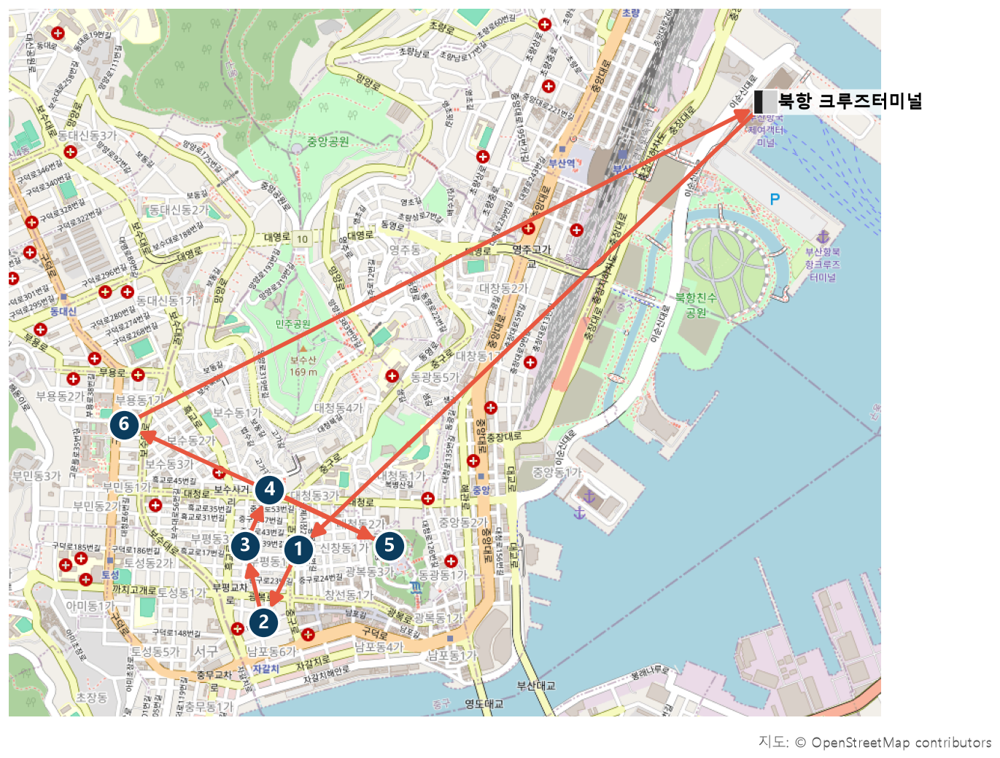

# 🚢 크루즈 승객의 부산 패싱 끊기

> **하선 시간 안에, 배를 놓치지 않고, 외국인이 원하는 부산 음식으로.**
> 상륙 시간·가게 영업시간·줄·이동시간·승선 마감을 한꺼번에 계산해 크루즈 승객에게 “부산 한 끼” 루트를 추천하는 최적화 모델

2026 지산학 아이디어톤 「부산의 맛, 로컬에서 글로컬」 · 크루즈 미식 루트 팀


<sub>S1 북항 당일 기항 · 08:30 하선 → 국제시장 → 부평깡통시장 → BIFF 씨앗호떡 → 성일집(자갈치 곰장어) → 히떼로스터리(전포) → 동래할매파전 → 해운대시장 → 16:10 복귀 · 지도 © OpenStreetMap contributors</sub>

**목차** · [한눈에 보기](#한눈에-보기) · [서비스](#서비스-busan-bite-pass) · [진행 과정](#진행-과정) · [데이터](#데이터) · [분석](#분석) · [모델](#모델) · [결과](#결과) · [검토와 개선](#검토와-개선) · [재현하기](#재현하기) · [한계](#한계와-다음-단계)

---

## 한눈에 보기

| | |
|---|---|
| **문제** | 크루즈 승객은 2026년 1~7월 **403,188명(+175.7%)** 으로 늘었지만, 중구 외국인 카드소비의 **약 66%가 쇼핑(면세 포함)**. 배에서 내려 면세점만 들르고 돌아가는 “부산 패싱” |
| **원인** | ① 상륙 8시간 남짓 ② 가게 영업·브레이크를 모름 ③ 줄·이동에 시간 낭비 ④ 한꺼번에 내려 같은 곳에 몰림 |
| **해결** | 외국인 댓글로 만든 **수요점수**를 최대화하고, 위 네 가지를 **제약**으로 둔 시간창 오리엔티어링(OPTW) 최적화 |
| **결과** | 6개 시나리오 모두 수업식 탐욕법보다 높음(S1 **+6.3%**) · 대표 루트 7곳 중 3곳이 원도심 밖 · 무작위 1,000회 모의 **지각 1.2%, 규칙 준수 98.8%** |

## 서비스: Busan Bite Pass


`06_서비스/index.html`을 브라우저로 열면 됩니다(인터넷 없이도 동작, 지도 이미지 포함).

| 탭 | 하는 일 |
|---|---|
| **내 루트** | 하선 터미널·하선 시각·승선 마감을 고르면 최적 루트, 실제 지도, 시간표(이동수단·줄·가격·영업시간), 복귀 알림 시각 |
| **상인 수요 예보** | 같은 입항 정보로 가게별·시간대별 예상 크루즈 손님 (예시: 2026.5.8 2척 동시 기항) |
| **데이터 처리 지도** | 원데이터 → 처리 코드 → 정제 표 → 분석·모델 → 결과물. 상자를 누르면 한 일·파일·다음 단계 |

- 한국어·English·中文·日本語. 가게 이름·메뉴(영·일)는 부산시 맛집 API, 중국어와 시장·마을 이름은 직접 표기
- 최적화는 1회 약 2분이 걸려, 터미널 2 × 하선 08:00~13:00(30분 간격) × 가용 3~9시간 = **154개 조건을 미리 풀어** 두고 가장 가까운 조건을 보여 준다 (`03_코드/make_service_routes.py`, 14코어 병렬 약 1시간)
- 지도: OpenStreetMap 타일을 이어 붙인 이미지(© OpenStreetMap contributors)

## 진행 과정

| 단계 | 한 일 |
|---|---|
| 1주차 | 부산 음식 점수표 아이디어 → 근거가 부족해 폐기 |
| 2주차 | 크루즈 승객의 짧은 상륙 시간과 “부산 패싱”으로 문제 정의 |
| 3주차 ① 수집·정제 | 입출항 신고, 데이터랩 외국인 카드소비, YouTube 댓글, 부산시 맛집 API, OSRM 이동시간 |
| 3주차 ② 분석·모델 | 퍼널, 원도심 vs 비교 지역, 수요점수, OPTW 최적화 |
| 3주차 ③ 검토·개선 | Codex 검토 3회 → 오류 수정, 역사 음식 → 외국인 수요로 방향 전환, 추정 → 실제 가게 데이터 |
| 3주차 ④ 결과물 | 시나리오별 시간표와 실제 지도, 보고서(공고 서식)·발표자료 |

## 데이터

| 원데이터 | 출처 · 받은 방법 | 규모 | 쓰임 |
|---|---|---|---|
| 크루즈 입출항 신고정보 | 공공데이터포털 15164568 (CSV) | 656행 → 중복 제거 648건, 2023.1~2026.7 | 승객 수, 하선·승선 시각 |
| 외국인 방문자·카드소비 | 한국관광데이터랩 (로그인 조회) | 6개 구 × 12개월, 업종별 | 쇼핑 쏠림, 원도심 비교 |
| YouTube 댓글 | YouTube Data API v3 (영·중·일 검색 상위 영상) | 1,792개 (영·중·일 1,492개, 작성자명 미저장) | 음식 범주별 수요점수 |
| 부산맛집정보 | 공공데이터포털 15063472 (부산시 API) | 536곳, 국문·영문·일문 | 가게 13곳의 실제 영업·브레이크·좌표 |
| 도로 이동시간 | OSRM 공개 API | 21개 지점 480쌍 | 택시·도보 이동 분 |
| 참고 | 제주 크루즈 실태조사, 대만 관광객 설문, 언론 보도 | — | 비교·국적 가중치(예시) |

**처리 과정**

| 원데이터 | 처리 | 결과 표 |
|---|---|---|
| 입출항 신고 | cp949 읽기 → 중복 제거(656→648) → 체류시간 계산 → 기항 유형·기항일 | `체류시간요약`, `연도별실적`, `기항일여부` |
| 데이터랩 | 구·월별 정리 → 원도심 3구 vs 비교 3구 → 식음료 지수·비중 | `외국인소비_원도심비교` |
| YouTube 댓글 | 문자로 언어 판정(가나=일, 한자=중, 라틴=영) → 메뉴 사전 매칭 → 범주별 언급 수 | `메뉴언급_언어별` |
| 맛집 API | 가게명으로 지점과 짝짓기 → 영업·브레이크 파싱 → 좌표 교체 | `food_nodes`, `노드_실데이터대조` |
| OSRM | 21개 지점 전 쌍 경로 → 택시(+5분 호출) / 1.5km 이하 도보 | `travel_time` |

**숫자 맞추기**

| 2025년 승객 기준 | 항차 | 승객 |
|---|---|---|
| 언론 보도(부산항만공사 발표 인용) | 203 | 257,000 |
| 입출항 신고 전체(중복 제거) — **분석 기준** | 197 | 249,541 |
| 체류 분석 표본(체류 0~96시간) | 171 | 246,584 |

| 기항 유형 | 항차 | 승객 비중 | 상륙 가능 시간 중앙값 |
|---|---|---|---|
| 8시간 이하 | 66 | 6.7% | 4.75시간 |
| 8~13시간 | 451 | 81.4% | 8.47시간 |
| 오버나잇 | 94 | 11.9% | 14.33시간 |

**추정 → 실제 가게 데이터**: 웹 검색으로 추정했던 영업시간·좌표를 부산시 맛집 API와 대조해 19곳 중 13곳을 교체. 예: 원조18번완당 마감 22:00→19:30, 60년 전통 할매국밥 22:00→19:00, 동래할매파전 브레이크 15~17시 추가, 골목 단위 좌표는 최대 3.3km 차이 (`02_정제데이터/노드_실데이터대조_1118_B.csv`)

## 분석

- **퍼널**: ① 입항 403,188명 → ② 상륙 승객(미측정, 법무부 통계 필요) → ③ 원도심 3구가 외국인 소비의 19~23% → ④ 원도심 식음료 +76% (비교 3구 +57%) → ⑤ 해산물·회 86건, 면 39건(댓글). 단계마다 모집단이 달라 전환율로 곱하지 않음


- **원도심 vs 비교 지역**: 2025.10→2026.7 외국인 식음료 지수 원도심 176 vs 비교 157. 같은 기간 크루즈 승객 월 2.2만 → 8.0만 명이지만 월별 상관 r=0.14로 약해 **연관**으로만 해석
- **수요점수**: 음식 범주별 댓글 언급 수 → `50 + 50·ln(1+언급)/ln(87)` (해산물 100 … 어묵 62)

## 모델

```
수집 ─▶ 정제 ─▶ 수요점수 ─▶ 최적화(OPTW) ─▶ 검증 ─▶ 시간표·지도
```

- **목적함수**: `Σ 수요점수 × 국적 가중치 − 0.8 × (줄 대기 + 이동 시간)`
- **제약**: 승선 30분 전 복귀 · 영업/브레이크타임(재개장 대기 포함) · 시간대 혼잡 줄(크루즈 가중 1.6) · 위 용량(100분에 1 소화) · 식사 간격 120분 · 최대 7곳
- **풀이**: 분기한정법으로 최적해 보장. 같은 제약의 탐욕법과 제약을 무시한 계획을 기준선으로 비교
- **검증**: 대기 ±30%·이동 ±20% 무작위 1,000회, 재최적화 안정성, 같은 배 여러 그룹의 혼잡 분산

## 결과

| 시나리오 | 최적화 | 탐욕법 | 복귀 | 방문 | 원도심 밖 |
|---|---|---|---|---|---|
| S1 북항 당일 기항 (08:30~16:30) | **504.6** | 474.5 | 16:10 | 7곳 | 3곳 |
| S2 영도 짧은 기항 | **298.2** | 294.1 | 15:33 | 4곳 | 0곳 |
| S3 오버나잇 2일차 | **520.1** | 493.2 | 16:21 | 7곳 | 3곳 |
| S4 모항 승선 전 (체크인 15:30) | **354.7** | 346.7 | 14:51 | 5곳 | 0곳 |
| S5 비기항일 | **514.8** | 483.5 | 15:58 | 7곳 | 3곳 |
| S6 S1 + 대만 선호 가중 | **543.1** | 528.6 | 15:19 | 7곳 | 3곳 |

- 시간표로 다시 계산해도 6개 모두 점수가 같고 규칙 위반 0건 (`02_정제데이터/루트시간표_1118_B.csv`)
- 제약을 무시한 계획은 11곳을 돌고 21:54 복귀 — 배를 놓치고 위반 7건
- 검증: 복귀 지각 1.2%, 전체 규칙 준수 98.8%, 복귀 여유 하위 5% 3.6분 → 해운대·동래는 선택 구간 + 승선 2시간 전 알림
- 혼잡 분산(같은 배 6그룹, 100명씩): 모두 같은 루트면 평균 줄 176~329분·6그룹 모두 위반 → 그룹마다 다른 루트면 **80~84분**, 위반 2그룹(+4분 가정)·0그룹(+8분 가정) (`02_정제데이터/분산효과_1118_B.csv`)
- 2026.5.8 실제 2척 동시 기항일(7,831명, 앱 이용 10% 가정): 8그룹 중 5그룹 규칙 준수, 3그룹(155명)은 불가 → 가게 확충 필요 (`골목방문시나리오_20260508_B.csv`)

| | |
|---|---|
|  |  |
| S2 영도 짧은 기항 — 원도심 4곳만 | S4 모항 승선 전 — 영도·자갈치·남포동 반나절 |

## 검토와 개선

| 검토 | 주요 지적 | 고친 것 |
|---|---|---|
| Codex 1차 (12건) | 기다리면 갈 수 있는 가게 누락, 위 소화 누락, 탐욕법과 제약 불일치, 퍼널 분모 혼재 | 대기 선택, 체류 중 소화, 같은 제약의 탐욕법, 퍼널 재작성 |
| Codex 2차 (8건) | 줄 서기 시점 판정, 분산 재평가 불일치, 위험도 평가 누락 | 먹기 시작 기준 판정, 공동 반복평가, 공통 평가기 |
| Codex 3차 (4건) | 브레이크 후 재개장 대기 누락, 비수렴 결과 집계, 해 없음 처리 | 재개장 후보, 비수렴=실패, 빈 루트 처리 |

모델 버전: **v1** 부산 고유성 점수·16곳·추정 영업시간 → **v2** 외국인 수요점수·19곳·“부산 패싱” 방향 → **v3** 부산시 맛집 API로 13곳 실제 영업·좌표. 검토 원문은 `05_문서/review/`.

## 결과물

| 파일 | 내용 |
|---|---|
| `05_문서/3주차_발표자료.pptx` | 발표자료 40장 (7개 섹션, 모든 슬라이드에 발표 대본 노트) |
| `05_문서/3주차_발표대본.md` | 발표 대본 (슬라이드별, 연습용) |
| `06_서비스/` | Busan Bite Pass 웹 서비스 (index.html + data.js + 지도 이미지) |
| `05_문서/3주차_팀활동보고서.docx` | 공고문 별첨 서식의 3주차 보고서 9쪽 (진행 과정·데이터 처리·분석·모델과 검토·결과·한계) |
| `02_정제데이터/루트시간표_1118_B.csv` | 6개 시나리오 시간표 (이동수단·도착·줄·식사·복귀) |
| `04_그림/그림8_S1~S6루트지도.png` | 실제 지도 위 시나리오별 루트 |
| `04_그림/루트지도_1118_B.html` | 인터랙티브 지도 (브라우저로 열기) |

## 폴더 구조

```
00_대회·수업자료/   공고문, 수업 노트북(경주 예제)
01_원천데이터/      공공데이터포털·데이터랩·YouTube·부산시 맛집 API 원본
02_정제데이터/      분석 결과 CSV (내용_MMDD_역할.csv), 노드 설명
03_코드/            분석·모델·시간표 코드, 문서빌드/(보고서·발표자료 생성)
04_그림/            그림·지도
05_문서/            보고서·발표자료·발표 대본, Codex 검토 기록(review/)
06_서비스/          Busan Bite Pass 웹 서비스
```

## 재현하기

Python(pandas·numpy·matplotlib, Colab 기본 라이브러리) + Node(docx·pptxgenjs). 프로젝트 루트에서:

```bash
# 1) 수집 (API 키 필요: 루트의 .ent에 youtubeapikey = … / datagokrkey = …, 저장소에는 올리지 않음)
python 03_코드/collect_C_youtube.py            # YouTube 댓글
python 03_코드/collect_B_busanfood.py          # 부산시 맛집 API

# 2) 분석
python 03_코드/analysis_A_cruise_schedule.py   # 입출항 신고 → 기항 시간·연도별 실적
python 03_코드/analysis_A_datalab.py           # 데이터랩 외국인 카드소비 원도심 비교 + 그림9

# 3) 모델
python 03_코드/test_optw.py                    # 규칙 테스트
FAST=1 python 03_코드/run_B_model.py           # 루트·검증 (약 1시간)
python 03_코드/run_dispersion.py k4 & python 03_코드/run_dispersion.py k8 & python 03_코드/run_dispersion.py alley
python 03_코드/run_dispersion.py merge         # 혼잡 분산·골목 시나리오 (3개 병렬, 약 1시간)
python 03_코드/make_itinerary.py               # 시간표 + 실제 지도 위 루트

# 4) 서비스
python 03_코드/make_service_routes.py 14       # 154개 조건 최적 루트 사전 계산 (병렬, 약 1시간)
python 03_코드/make_service_data.py            # 장소(4개 언어)·루트·상인 예보·지도 → 06_서비스/data.js

# 5) 문서
cd 03_코드/문서빌드 && npm i docx pptxgenjs && node report.js && node deck.js
```

## 한계와 다음 단계

- **줄 대기 시간**은 공개 데이터가 없어 추정치 → 주요 가게 현장 측정 예정
- 영업시간·좌표는 19곳 중 13곳이 부산시 공공데이터, 시장·마을 6곳은 추정 (`02_정제데이터/노드_실데이터대조_1118_B.csv`)
- 수요점수는 음식 범주 단위이고 댓글 표본이 작음 → 리뷰로 가게 단위 확장
- 데이터랩은 월 단위라 기항일 효과는 일 단위 자료로 검증 필요
- 상륙 승객 수(퍼널 ②)는 미측정 → 법무부 상륙허가 통계 확보 필요
- 혼잡 분산은 그룹을 차례로 배정해 순서에 따라 결과가 달라지고, 가게 좌석 수는 반영하지 않음 → 동시 배정·수용력 제약으로 확장

<sub>공고문에 따라 결과물의 저작권 등 권리는 부산대학교에 귀속됩니다.</sub>
