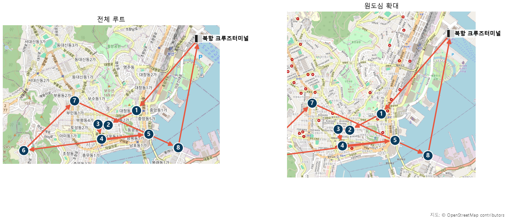
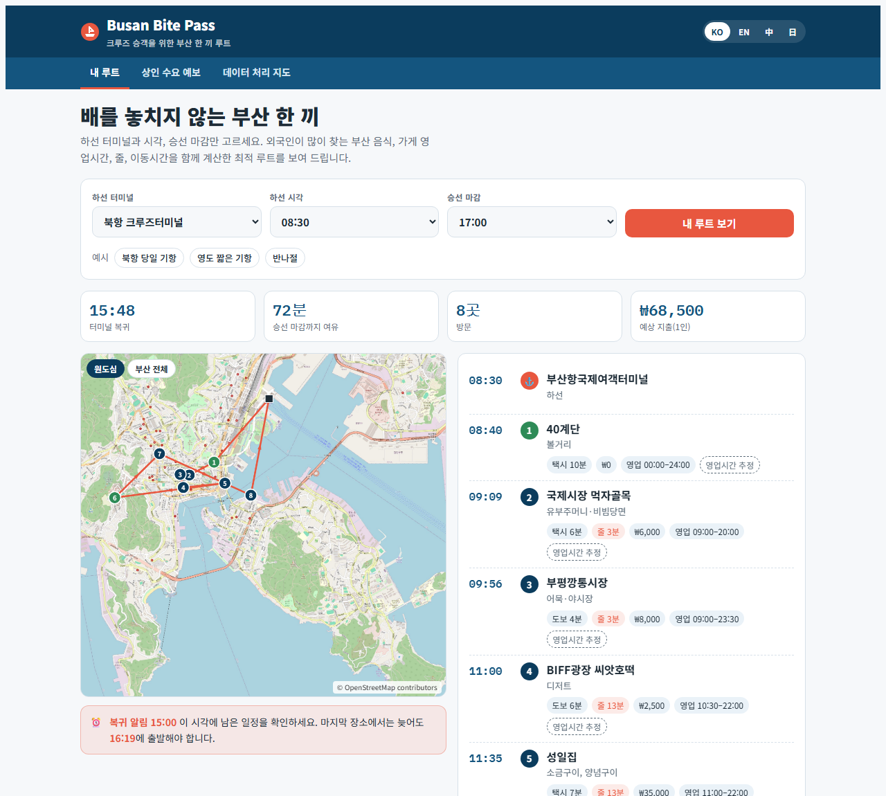
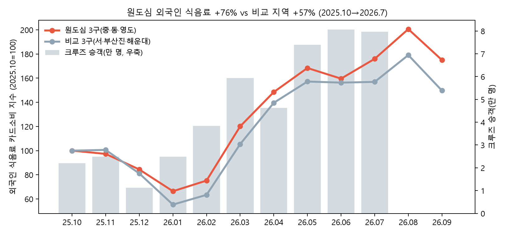
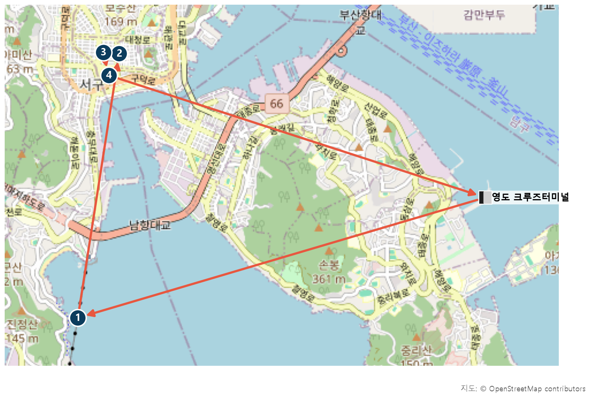

# 🚢 크루즈 승객의 부산 패싱 끊기

> **하선 시간 안에, 배를 놓치지 않고, 외국인이 원하는 부산 음식으로.**
> 상륙 시간·가게 영업시간·줄·이동시간·승선 마감을 한꺼번에 계산해 크루즈 승객에게 “부산 한 끼” 루트를 추천하는 최적화 모델

2026 지산학 아이디어톤 「부산의 맛, 로컬에서 글로컬」 · 크루즈 미식 루트 팀



<sub>S1 북항 당일 기항 · 08:30 하선 → 40계단 → 국제시장 → 부평깡통시장 → BIFF 씨앗호떡 → 성일집(자갈치 곰장어) → 감천문화마을 → 원조18번완당 → 봉래동 창고카페 → 15:48 복귀 (음식 6곳 + 볼거리 2곳) · 지도 © OpenStreetMap contributors</sub>

**목차** · [한눈에 보기](#한눈에-보기) · [서비스](#서비스-busan-bite-pass) · [진행 과정](#진행-과정) · [데이터](#데이터) · [분석](#분석) · [모델](#모델) · [결과](#결과) · [확률모델](#확률모델) · [교수님 피드백 반영](#교수님-피드백-반영) · [검토와 개선](#검토와-개선) · [재현하기](#재현하기) · [한계](#한계와-다음-단계)

---

## 한눈에 보기

| | |
|---|---|
| **문제** | 크루즈 승객은 2026년 1~7월 **403,188명(+175.7%)** 으로 늘었지만, 중구 외국인 카드소비의 **약 66%가 쇼핑(면세 포함)**. 배에서 내려 면세점만 들르고 돌아가는 “부산 패싱” |
| **원인** | ① 상륙 8시간 남짓 ② 가게 영업·브레이크를 모름 ③ 줄·이동에 시간 낭비 ④ 한꺼번에 내려 같은 곳에 몰림 |
| **해결** | 외국인 댓글로 만든 **수요점수**를 최대화하고, 위 네 가지를 **제약**으로 둔 시간창 오리엔티어링(OPTW) 최적화. 먹는 사이 **볼거리**(먹지 않는 곳)로 소화 시간을 채움 |
| **결과** | 6개 시나리오 모두 수업식 탐욕법보다 높음(S1 **+5.6%**) · 대표 루트 음식 6곳 + 볼거리 2곳 · 무작위 1,000회 모의 **지각 0%, 규칙 준수 97%** · 확률모델: 순위만 매긴 추천은 몰림을 만들고 밸런싱 추천이 이를 줄임 |

## 서비스: Busan Bite Pass



**바로 써 보기: https://ddayoung03.github.io/busan-bite-pass/** (휴대폰에서도 열림)

`06_서비스/index.html`을 브라우저로 열어도 됩니다(인터넷 없이도 동작, 지도 이미지 포함).

| 탭 | 하는 일 |
|---|---|
| **내 루트** | 하선 터미널·하선 시각·승선 마감을 고르면 최적 루트, 실제 지도, 시간표(이동수단·줄·가격·영업시간), 복귀 알림 시각. 볼거리는 초록 번호 |
| **상인 수요 예보** | 같은 입항 정보로 가게별·시간대별 예상 크루즈 손님 (예시: 2026.5.8 2척 동시 기항) |
| **데이터 처리 지도** | 원데이터 → 처리 코드 → 정제 표 → 분석·모델 → 결과물. 상자를 누르면 한 일·파일·다음 단계 |

- 한국어·English·中文·日本語. 가게 이름·메뉴(영·일)는 부산시 맛집 API, 중국어와 시장·마을 이름은 직접 표기
- 최적화는 1회 약 3~5분이 걸려, 터미널 2 × 하선 08:00~13:00(30분 간격) × 가용 3~9시간 = **154개 조건을 미리 풀어** 두고 가장 가까운 조건을 보여 준다. 154칸 모두 규칙 준수, 142칸에 볼거리 포함 (`03_코드/make_service_routes.py`, 8코어 병렬 약 1시간)
- 지도: OpenStreetMap 타일을 이어 붙인 이미지(© OpenStreetMap contributors)

## 진행 과정

| 단계 | 한 일 |
|---|---|
| 1주차 | 부산 음식 점수표 아이디어 → 근거가 부족해 폐기 |
| 2주차 | 크루즈 승객의 짧은 상륙 시간과 “부산 패싱”으로 문제 정의 |
| 3주차 ① 수집·정제 | 입출항 신고, 데이터랩 외국인 카드소비, YouTube 댓글, 부산시 맛집 API, OSRM 이동시간 |
| 3주차 ② 분석·모델 | 퍼널, 원도심 vs 비교 지역, 수요점수, OPTW 최적화 |
| 3주차 ③ 검토·개선 | Codex 검토 3회 → 오류 수정, 역사 음식 → 외국인 수요로 방향 전환, 추정 → 실제 가게 데이터 |
| 3주차 ④ 확장 | 볼거리 10곳(v4), 지역탐색, 복귀 안전여유 20분, 확률모델(대기행렬·마르코프·A/B·미분방정식) |
| 3주차 ⑤ 결과물 | 시나리오별 시간표와 실제 지도, 보고서(공고 서식)·발표자료, 서비스 |

## 데이터

| 원데이터 | 출처 · 받은 방법 | 규모 | 쓰임 |
|---|---|---|---|
| 크루즈 입출항 신고정보 | 공공데이터포털 15164568 (CSV) | 656행 → 중복 제거 648건, 2023.1~2026.7 | 승객 수, 하선·승선 시각 |
| 외국인 방문자·카드소비 | 한국관광데이터랩 (로그인 조회) | 6개 구 × 12개월, 업종별 | 쇼핑 쏠림, 원도심 비교 |
| YouTube 댓글 | YouTube Data API v3 (영·중·일 검색 상위 영상) | 음식 영상 1,792개 + 여행 영상 1,503개 (작성자명 미저장) | 음식 범주·명소별 수요점수 |
| 부산맛집정보 | 공공데이터포털 15063472 (부산시 API) | 536곳, 국문·영문·일문 | 가게 13곳의 실제 영업·브레이크·좌표 |
| 이동시간·좌표 | OSRM 공개 API · OSM Nominatim | 31개 지점(볼거리 10 포함) 1,072행 | 택시·도보 이동 분, 명소 좌표·운영시간 |
| 참고 | 제주 크루즈 실태조사, 대만 관광객 설문, 언론 보도 | — | 비교·국적 가중치(예시) |

**처리 과정**

| 원데이터 | 처리 | 결과 표 |
|---|---|---|
| 입출항 신고 | cp949 읽기 → 중복 제거(656→648) → 체류시간 계산 → 기항 유형·기항일 | `체류시간요약`, `연도별실적`, `기항일여부` |
| 데이터랩 | 구·월별 정리 → 원도심 3구 vs 비교 3구 → 식음료 지수·비중 | `외국인소비_원도심비교` |
| YouTube 댓글 | 문자로 언어 판정(가나=일, 한자=중, 라틴=영) → 메뉴·명소 사전 매칭 → 언급 수 | `메뉴언급_언어별`, `명소언급_1119_C` |
| 볼거리 | OSM 좌표·opening_hours, 운영사 안내(부산타워·책방골목), 머무는 시간은 팀 추정 → 노드 표에 추가 | `food_nodes`(A01~A10) |
| 맛집 API | 가게명으로 지점과 짝짓기 → 영업·브레이크 파싱 → 좌표 교체 | `food_nodes`, `노드_실데이터대조` |
| OSRM | 31개 지점 전 쌍 경로 → 택시(+5분 호출) / 1.5km 이하 도보 | `travel_time` |

**숫자 맞추기**

| 2025년 승객 기준 | 항차 | 승객 |
|---|---|---|
| 언론 보도(부산항만공사 발표 인용) | 203 | 257,000 |
| 입출항 신고 전체(중복 제거) — **분석 기준** | 197 | 249,541 |
| 체류 분석 표본(체류 0~96시간) | 171 | 246,584 |

| 기항 유형 | 항차 | 승객 비중 | 상륙 가능 시간 중앙값 |
|---|---|---|---|
| 8시간 이하 | 66 | 6.7% | 4.75시간 |
| 8~13시간 | 451 | 81.4% | 8.47시간 |
| 오버나잇 | 94 | 11.9% | 14.33시간 |

**추정 → 실제 가게 데이터**: 웹 검색으로 추정했던 영업시간·좌표를 부산시 맛집 API와 대조해 19곳 중 13곳을 교체. 예: 원조18번완당 마감 22:00→19:30, 60년 전통 할매국밥 22:00→19:00, 동래할매파전 브레이크 15~17시 추가, 골목 단위 좌표는 최대 3.3km 차이 (`02_정제데이터/노드_실데이터대조_1118_B.csv`)

## 분석

- **퍼널**: ① 입항 403,188명 → ② 상륙 승객(미측정, 법무부 통계 필요) → ③ 원도심 3구가 외국인 소비의 19~23% → ④ 원도심 식음료 +76% (비교 3구 +57%) → ⑤ 해산물·회 86건, 면 39건(댓글). 단계마다 모집단이 달라 전환율로 곱하지 않음


- **원도심 vs 비교 지역**: 2025.10→2026.7 외국인 식음료 지수 원도심 176 vs 비교 157. 같은 기간 크루즈 승객 월 2.2만 → 8.0만 명이지만 월별 상관 r=0.14로 약해 **연관**으로만 해석
- **월별 기항 횟수 × 구·업종 카드소비** (10개월): 기항이 많은 달에 6개 구 모두 외국인 식음료 소비가 함께 늘었다(r = 0.61~0.79). 그러나 원도심 식음료 비중(원도심 − 비교)과 기항 횟수의 상관은 r = 0.02 → 월 단위로는 크루즈 효과와 부산 전체 성수기를 떼어 낼 수 없다 → 기항일·비기항일은 현장 관측으로 (`02_정제데이터/기항횟수_소비관계_1120_A.csv`)
- **수요점수**: 음식 범주별 댓글 언급 수 → `50 + 50·ln(1+언급)/ln(87)` (해산물 100 … 어묵 62)
- **볼거리 수요점수**: 여행 영상 댓글의 명소 언급 수에 같은 식 → 감천문화마을 34건(100) · 송도 케이블카 14건(88) · 광안리 12건(86) … (음식과는 다른 영상 묶음 안의 상대 점수)

## 모델

```
수집 ─▶ 정제 ─▶ 수요점수 ─▶ 최적화(OPTW) ─▶ 검증 ─▶ 시간표·지도
```

- **목적함수**: `max Σᵢ uᵢyᵢ − 0.8 × Σ(대기 + 이동)` (yᵢ = 점포 i 방문 여부, uᵢ = 외국인 수요점수 × 국적 가중치), `s.t. a복귀 ≤ T승선 마감 − 30분`
- **시간 흐름**: `aⱼ ≥ aᵢ + wᵢ + sᵢ + tᵢⱼ` (다음 도착 = 앞 도착 + 대기·체류·이동), 영업시간 안에 대기·체류를 마침
- **수용인원**: 같은 배 여러 그룹을 배정할 때 점포별 1시간 안 인원 ≤ 시간당 수용인원(창구·테이블 수 × 60/처리 분 × 일행 3명, 가정 → 현장 관측값으로 교체)
- **제약**: 승선 30분 전 복귀(계획할 때는 **20분 더 여유**) · 영업/브레이크타임(재개장 대기 포함) · 시간대 혼잡 줄(크루즈 가중 1.6) · 위 용량(100분에 1 소화, 볼거리는 0) · 식사 간격 120분 · **음식 7곳 + 볼거리 2곳**
- **풀이(v4, 3단계)**: ① 음식만 분기한정(음식 5·6·7곳 각각 최적) → ② 볼거리 끼워 넣기 → ③ 지역탐색(넣기·빼기·바꾸기·옮기기, 탐욕 해에서도 출발). 탐욕법보다 나빠지지 않지만 음식+볼거리 **결합 최적은 보장하지 않는 휴리스틱**. 31노드를 한꺼번에 분기한정하면 30분 넘게 끝나지 않아 이렇게 나눴다
- **복귀 안전여유**: 여유 없이 점수만 올리면 지역탐색이 복귀 직전까지 일정을 채워 S1 지각 확률이 61%까지 올랐다 → 계획에만 20분 여유를 의무화(지각 판정은 원래 마감)
- **검증**: 대기 ±30%·이동 ±20% 무작위 1,000회, 재최적화 안정성, 같은 배 여러 그룹의 혼잡 분산

## 결과

| 시나리오 | 최적화 | 탐욕법 | 복귀 | 방문 | 원도심 밖 |
|---|---|---|---|---|---|
| S1 북항 당일 기항 (08:30~16:30) | **588.7** | 557.3 | 15:48 | 8곳 | 1곳 |
| S2 영도 짧은 기항 | **280.8** | 254.5 | 15:24 | 4곳 | 1곳 |
| S3 오버나잇 2일차 | **689.5** | 611.5 | 17:49 | 9곳 | 4곳 |
| S4 모항 승선 전 (체크인 15:30) | **376.9** | 325.8 | 14:37 | 5곳 | 1곳 |
| S5 비기항일 | **660.7** | 639.8 | 16:06 | 9곳 | 1곳 |
| S6 S1 + 대만 선호 가중 | **680.6** | 662.7 | 15:59 | 9곳 | 3곳 |

- 시간표로 다시 계산해도 6개 모두 점수가 같고 규칙 위반 0건 (`02_정제데이터/루트시간표_1118_B.csv`)
- 제약을 무시한 계획은 12곳을 돌고 21:46 복귀 — 배를 놓치고 위반 6건
- 검증(S1 고정 루트, 대기 ±30%·이동 ±20% 1,000회): 복귀 지각 **0%**, 전체 규칙 준수 97%(위반은 식사 간격 3%), 복귀 여유 중앙값 39.7분·하위 5% 24.6분. 재최적화 20회 중 같은 방문 집합 5% → 줄이 바뀌면 최적 루트도 바뀌므로 154개 조건을 미리 풀어 둔다
- 혼잡 분산(같은 배 6그룹, 30명씩, 점포 수용인원 반영): 모두 같은 루트면 평균 줄 97~124분·6그룹 모두 위반 → 그룹마다 다른 루트면 **55분**, 위반 0그룹(+4분·+8분 가정 모두) (`02_정제데이터/분산효과_1118_B.csv`)
- 2026.5.8 실제 2척 동시 기항일(7,831명, 앱 이용 10% 가정 = 626명, 그룹당 약 40명 17그룹): 점포 수용인원 안에서 공동 평가가 수렴하는 배정을 찾지 못함(미수렴 = 실패) → 시간 분산·예약·가게 확충 필요. 상인 예보는 앱이 추천한 방문 계획 전체로 만든다 (`상인예보_20260508_B.csv`)

| | |
|---|---|
|  |  |
| S2 영도 짧은 기항 — 40계단·감천 + 시장·호떡 | S4 모항 승선 전 — 시장·호떡 사이 감천·부산타워 |

### 인기순 경로와 비교

인기순 경로 = 수요점수가 높은 곳부터 규칙만 지키며 차례로 방문(동선 최적화 없음). 총 대기 = 줄 + 문 열기·식사 간격 기다림.

| 시나리오 | 최적: 점포·총 대기·복귀 여유 | 인기순: 점포·총 대기·복귀 여유 |
|---|---|---|
| S1 | 8곳 · 56분 · 42분 | 4곳 · 195분 · 23분 |
| S2 | 4곳 · 11분 · 21분 | 3곳 · 20분 · 22분 |
| S3 | 9곳 · 48분 · 48분 | 5곳 · 248분 · 23분 |
| S4 | 5곳 · 25분 · 23분 | 2곳 · 105분 · 38분 |
| S5 | 9곳 · 38분 · 24분 | 4곳 · 196분 · 28분 |
| S6 | 9곳 · 52분 · 30분 | 4곳 · 230분 · 29분 |

최적 경로는 모든 시나리오에서 더 많이 들르고 덜 기다린다. 복귀 여유는 비슷하다(인기순은 적게 들르는 대신 S2·S4에서 여유가 조금 더 많음). `02_정제데이터/인기순비교_1120_E.csv`, 그림15

### 스트레스 테스트와 예비 경로

| 시나리오 | 하선 20분 지연 | 점심 단체 도착(11:30~13:30, 200명) |
|---|---|---|
| S1 | × → 40계단 빼면 15:43 복귀 | ○ |
| S2 | ○ | ○ |
| S3 | ○ | ○ |
| S4 | × → 부산타워 빼면 14:23 | ○ |
| S5 | × → 40계단 빼면 16:02 | × → 삼진어묵 빼면 15:59 |
| S6 | ○ | × → 40계단 빼면 16:29 |

○ = 승선 마감 30분 전까지 복귀·모든 규칙 준수, × = 규칙 위반 → 장소를 하나씩 빼는 예비 경로로 해결. 서비스 154칸 중 88칸은 하선 20분 지연 시 B안이 필요해 화면에 “20분 늦어지면 ○○ 빼고 가세요”로 표시 (`06_서비스/plan_b.json`, `02_정제데이터/스트레스테스트_1120_E.csv`)

## 확률모델

`03_코드/analysis_D_stochastic.py` — 최적 루트(S1 상위 5개 + 분산 배정 루트)를 입력으로, 추천 방식이 줄·복귀·쏠림에 주는 영향을 본다. **좌석·창구 수, 점심 피크 가동률 0.8, 앱 이용 60명, 순위별 선택 확률 0.55^순위, 미분방정식 계수는 가정**이라 절대 숫자보다 비교의 방향을 본다.

| 모델 | 무엇을 | 결과 |
|---|---|---|
| 대기행렬 M/M/c (Erlang C) | 앱 손님이 가게 줄을 얼마나 늘리나 | 가동률이 1에 가까워지면 줄이 급증 → 이용자 30~300명 모든 규모에서 추가 대기: 밸런싱 < 나열 < 순위 표시 (그림14) |
| 마르코프 연쇄 정상분포 | 승객 흐름(터미널→가게→…→터미널)의 가게별 장기 방문 비중 | 1위만 추천하면 그 루트 가게에 갇힘, 밸런싱하면 퍼지고 빨리 섞임: 둘째 고윳값 |λ2| 0.94 → 0.71 (그림11) |
| 로짓 균형(연속 평균법) | 줄이 길어지는 루트의 추천 확률을 낮춰 수렴 | 비슷한 상위 루트끼리만 섞으면 효과 없음 → 서로 다른 분산 배정 루트까지 후보에 넣어야 함 |
| A/B 시뮬레이션 (400회) | C 앱 없음 / A 나열 / B 순위 / B* 밸런싱 | 앱 때문에 늘어난 대기 C 471분 · B 245분 · A 60분 · **B* 34분** (그림12). 지각률이 높은 것은 피크 가동률 가정 탓 → 현장 A/B(기항일 무작위 배정)로 확인 |
| 2차원 선형 미분방정식 | x=이용 승객, y=혼잡. 고윳값으로 거동 분류 | 두 방식 모두 안정 나선(실수부 −0.3). 진동 세기(허수부) 순위 2.0 → 밸런싱 0.64: 몰림·썰물 반복이 줄어듦 (그림13) |

## 교수님 피드백 반영

| 피드백 | 반영 |
|---|---|
| 승선 마감·이동·대기열·수용인원 반영이 강점 | 수용인원을 최적화 제약으로 추가(여러 그룹 배정 시 점포별 시간당 인원 상한) |
| 핵심 질문: 승선 마감 30분 전까지 돌아오나 | 검증 슬라이드를 이 질문으로: 1,000회 모의 지각 0%, 계획은 20분 여유 |
| 수식 max Σuᵢyᵢ, a복귀 ≤ T − 30분 | 발표·README 수식을 같은 표기로 |
| 인기순 경로와 총 대기·방문 수·복귀 여유 비교 | `analysis_E_robustness.py` → 위 표 |
| 20분 지연·점심 단체 도착 → 예비 경로 | 같은 스크립트 → 위 표, 서비스 B안 |
| 월·구·업종 카드소비 ↔ 월별 기항 횟수 | `analysis_A_datalab.py` → 분석 절 |
| 점포 5곳 도착·처리 시작·종료·창구 수·퇴장 기록, 기항일 vs 비기항일 | `05_문서/현장관측_계획.md`, 기록지 `05_문서/현장관측_기록지.csv`, 추정 `analysis_F_observation.py`(λ·μ·c → Erlang C, 수용인원 → 모델), 관측일 추천 `--plan <스케줄 CSV>` |

## 검토와 개선

| 검토 | 주요 지적 | 고친 것 |
|---|---|---|
| Codex 1차 (12건) | 기다리면 갈 수 있는 가게 누락, 위 소화 누락, 탐욕법과 제약 불일치, 퍼널 분모 혼재 | 대기 선택, 체류 중 소화, 같은 제약의 탐욕법, 퍼널 재작성 |
| Codex 2차 (8건) | 줄 서기 시점 판정, 분산 재평가 불일치, 위험도 평가 누락 | 먹기 시작 기준 판정, 공동 반복평가, 공통 평가기 |
| Codex 3차 (4건) | 브레이크 후 재개장 대기 누락, 비수렴 결과 집계, 해 없음 처리 | 재개장 후보, 비수렴=실패, 빈 루트 처리 |

모델 버전: **v1** 부산 고유성 점수·16곳·추정 영업시간 → **v2** 외국인 수요점수·19곳·“부산 패싱” 방향 → **v3** 부산시 맛집 API로 13곳 실제 영업·좌표 → **v4** 볼거리 10곳·지역탐색·복귀 여유 20분 (v3 노드·이동시간 표는 `*_v3백업.csv`). 검토 원문은 `05_문서/review/`.

## 결과물

| 파일 | 내용 |
|---|---|
| `05_문서/3주차_발표자료.pptx` | 발표자료 45장 (7개 섹션, 볼거리·확률모델 포함, 모든 슬라이드에 발표 대본 노트) |
| `05_문서/3주차_발표대본.md` | 발표 대본 (슬라이드별, 연습용) |
| `06_서비스/` | Busan Bite Pass 웹 서비스 (index.html + data.js + 지도 이미지) |
| `05_문서/3주차_팀활동보고서.docx` | 공고문 별첨 서식의 3주차 보고서 9쪽 (진행 과정·데이터 처리·분석·모델과 검토·결과·한계) |
| `02_정제데이터/루트시간표_1118_B.csv` | 6개 시나리오 시간표 (이동수단·도착·줄·식사·복귀) |
| `04_그림/그림8_S1~S6루트지도.png` | 실제 지도 위 시나리오별 루트 |
| `04_그림/루트지도_1118_B.html` | 인터랙티브 지도 (브라우저로 열기) |
| `04_그림/그림11~15` | 마르코프 수렴 · A/B 시뮬레이션 · 위상도 · 수용 한계 · 인기순 비교 |
| `05_문서/현장관측_계획.md`, `현장관측_기록지.csv` | 점포 5곳 대기열 관측 계획과 기록지 |

## 폴더 구조

```
00_대회·수업자료/   공고문, 수업 노트북(경주 예제)
01_원천데이터/      공공데이터포털·데이터랩·YouTube·부산시 맛집 API 원본
02_정제데이터/      분석 결과 CSV (내용_MMDD_역할.csv), 노드 설명
03_코드/            분석·모델·시간표 코드, 문서빌드/(보고서·발표자료 생성)
04_그림/            그림·지도
05_문서/            보고서·발표자료·발표 대본, Codex 검토 기록(review/)
06_서비스/          Busan Bite Pass 웹 서비스
```

## 재현하기

Python(pandas·numpy·matplotlib, Colab 기본 라이브러리) + Node(docx·pptxgenjs). 프로젝트 루트에서:

```bash
# 1) 수집 (API 키 필요: 루트의 .ent에 youtubeapikey = … / datagokrkey = …, 저장소에는 올리지 않음)
python 03_코드/collect_C_youtube.py            # YouTube 댓글
python 03_코드/collect_B_busanfood.py          # 부산시 맛집 API
python 03_코드/collect_C_attractions.py        # 여행 영상 댓글 → 명소 언급
python 03_코드/make_attraction_nodes.py        # 볼거리 10곳 노드 + OSRM 이동시간 추가

# 2) 분석
python 03_코드/analysis_A_cruise_schedule.py   # 입출항 신고 → 기항 시간·연도별 실적
python 03_코드/analysis_A_datalab.py           # 데이터랩 외국인 카드소비 원도심 비교 + 그림9

# 3) 모델
python 03_코드/test_optw.py                    # 규칙 테스트
FAST=1 python 03_코드/run_B_model.py           # 루트·검증 (약 1시간)
python 03_코드/run_dispersion.py k4 & python 03_코드/run_dispersion.py k8 & python 03_코드/run_dispersion.py alley
python 03_코드/run_dispersion.py merge         # 혼잡 분산·골목 시나리오 (3개 병렬, 약 1시간)
python 03_코드/make_itinerary.py               # 시간표 + 실제 지도 위 루트
python 03_코드/analysis_D_stochastic.py        # 확률모델 (대기행렬·마르코프·A/B·미분방정식)
python 03_코드/analysis_E_robustness.py        # 인기순 비교·스트레스 테스트·예비 경로(서비스 B안)
python 03_코드/analysis_F_observation.py       # 현장 관측 기록 → λ·μ·c 추정 (--selftest, --plan 스케줄.csv)

# 4) 서비스
python 03_코드/make_service_routes.py 8        # 154개 조건 최적 루트 사전 계산 (병렬, 약 1시간)
python 03_코드/make_service_data.py            # 장소(4개 언어)·루트·상인 예보·지도 → 06_서비스/data.js

# 5) 문서
cd 03_코드/문서빌드 && npm i docx pptxgenjs && node report.js && node deck.js
```

## 한계와 다음 단계

- **줄 대기 시간·좌석 수**는 공개 데이터가 없어 추정치 → 점포 5곳 현장 관측(`05_문서/현장관측_계획.md`) 후 교체 예정. 그래서 확률모델 숫자는 경향만 본다
- 볼거리의 머무는 시간은 팀 추정, 일부 운영시간(감천·태종대·케이블카 마감)도 추정
- v4 풀이는 결합 최적을 보장하지 않는 휴리스틱(음식 단계만 최적 보장)
- 영업시간·좌표는 19곳 중 13곳이 부산시 공공데이터, 시장·마을 6곳은 추정 (`02_정제데이터/노드_실데이터대조_1118_B.csv`)
- 수요점수는 음식 범주 단위이고 댓글 표본이 작음 → 리뷰로 가게 단위 확장
- 데이터랩은 월 단위라 기항일 효과는 일 단위 자료로 검증 필요
- 상륙 승객 수(퍼널 ②)는 미측정 → 법무부 상륙허가 통계 확보 필요
- 혼잡 분산은 그룹을 차례로 배정해 순서에 따라 결과가 달라질 수 있고, 수용인원은 가정값 → 관측값으로 교체, 동시 배정으로 확장

<sub>공고문에 따라 결과물의 저작권 등 권리는 부산대학교에 귀속됩니다.</sub>
